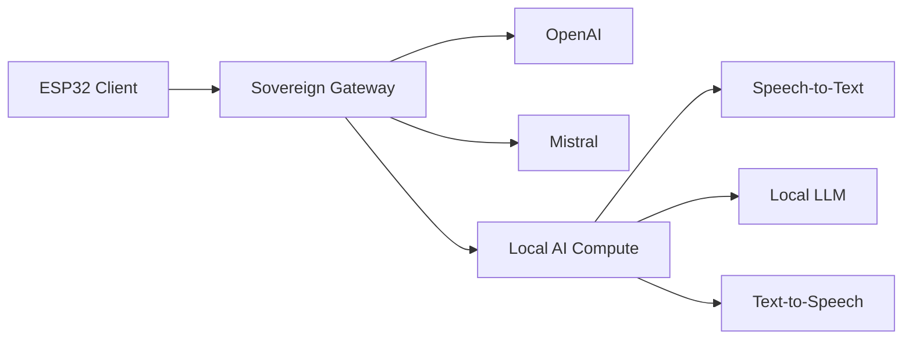

# MyAI — Reference Architecture

## Purpose

MyAI is a reference architecture for running an AI assistant with an explicit and replaceable trust boundary between the client, the AI gateway and the selected AI provider.

It is not intended as a build recipe or a recommendation for specific hardware.

The reference implementation happens to use a refurbished x86 desktop as its local compute node, because that was a practical and economical choice in this environment. A mini-PC, workstation, server, laptop or another platform may be a better choice elsewhere.

> **The compute node is replaceable. The architecture is the important part.**

---

## Architecture drivers

Several design drivers shaped this architecture.

### Sovereignty

Sovereignty does not necessarily mean that everything must run locally.

It means maintaining meaningful control over:

- where data flows;
- which provider processes it;
- which dependencies exist;
- whether components can be replaced;
- whether external services can be removed without redesigning the client;
- and whether the system can be stopped when required.

The architecture therefore avoids embedding provider-specific knowledge in the client.

### Replaceability

OpenAI, Mistral and a local AI stack are treated as implementations behind the gateway rather than as permanent architectural dependencies.

Changing provider should not require changing the ESP32 client.

### Production readiness

Moving AI from an experiment into production requires more than getting a model to answer a question.

The system must also expose:

- readiness;
- lifecycle state;
- failures;
- timing;
- provider selection;
- resource use;
- and operational behavior.

An AI system that cannot explain whether it is `off`, `waking`, `warming` or `ready` is difficult to operate reliably.

### Demonstrable control

Governance and security controls should not exist only in documentation.

Where practical, behavior should be observable and testable.

Examples include:

- explicit backend selection;
- observable compute state;
- no hidden cloud fallback;
- bounded interfaces;
- measurable startup time;
- explicit network flows;
- and the ability to physically remove compute capability.

### Operational cost

Local AI is not free simply because it does not have an API invoice.

Hardware, electricity, cooling, maintenance, updates, and idle power are also architecture concerns.

For that reason, the local compute node is intended to be powered only when needed.

---

## High-level architecture



The most important boundary is the gateway.

The ESP32 communicates with one stable interface.

It does not know whether the selected AI backend is:

- OpenAI;
- Mistral;
- a local model;
- or something that does not exist yet.

---

## Responsibility boundaries

### Client

The client is intentionally kept simple.

Its responsibilities are limited to functions such as:

- user interaction;
- audio capture;
- audio playback;
- display;
- connecting to the gateway;
- and checking whether the selected backend is ready.

The client does **not** know about:

- Ollama;
- Wake-on-LAN;
- the local compute hardware;
- OpenAI;
- Mistral;
- model loading;
- provider credentials;
- or backend-specific lifecycle behavior.

From the client perspective, the relevant question is simply:

> **Is the selected AI backend ready?**

---

### Sovereign Gateway

The gateway is the architectural control point.

It is responsible for:

- backend selection;
- protocol translation;
- authentication and secrets;
- lifecycle orchestration;
- observability;
- policy enforcement;
- data-flow boundaries;
- and provider-specific integrations.

The gateway deliberately separates the client from the provider.

This creates a replaceable boundary:

```text
Client
   |
   v
Stable gateway interface
   |
   +---- OpenAI
   |
   +---- Mistral
   |
   +---- Local AI
   |
   +---- Future backend
```

The gateway is therefore more than a proxy.

It is the point at which sovereignty becomes enforceable.

---

### Local compute node

The local compute node is an optional backend.

In the reference implementation it provides:

- Speech-to-Text;
- a local Large Language Model;
- Text-to-Speech.

The current implementation uses:

```text
STT   -> faster-whisper
LLM   -> Ollama / Qwen
TTS   -> Supertonic
```

None of these components should be considered permanent architectural dependencies.

They are replaceable implementations behind the local backend interface.

---

## Provider-neutral readiness

Local AI introduces a behavior that cloud APIs usually do not have: the compute node may be completely powered off.

The client must nevertheless remain provider-neutral.

For that reason, the gateway exposes a generic readiness interface:

```http
GET /compute/status
POST /compute/wake
```

The semantics are intentionally broader than the endpoint names might initially suggest.

`GET /compute/status` effectively means:

> Is the currently selected AI backend ready to accept a conversation?

For a cloud backend:

```json
{"state":"ready"}
```

can be returned immediately.

For a local backend, the lifecycle may instead be:

```text
off
  ↓
waking
  ↓
warming
  ↓
ready
```

The ESP32 does not need to understand the difference.

---

## Local compute lifecycle

The desired lifecycle is:

```text
OFF
 |
 | Wake-on-LAN
 v
WAKING
 |
 | Operating system and services start
 v
WARMING
 |
 | Model loaded into memory
 v
READY
 |
 | Conversation
 v
ACTIVE
 |
 | Conversation ends
 v
IDLE / WARM
 |
 | inactivity timeout
 v
SHUTDOWN
 |
 v
OFF
```

A future implementation may, for example, keep the model warm for 30 minutes after use and then shut the compute node down automatically.

This balances three concerns:

- response time;
- energy consumption;
- equipment lifetime and operational simplicity.

The lifecycle belongs to the gateway and compute node.

It does not belong in the ESP32 firmware.

---

## No hidden fallback

A deliberate design choice is:

> **If local AI is selected, failure of local AI must not silently move the conversation to a cloud provider.**

Automatic fallback may improve apparent availability, but it weakens sovereignty.

A user who deliberately selects local processing should not unknowingly send the same conversation to an external provider because a local component failed.

Fallback, if implemented at all, should therefore be:

- explicit;
- visible;
- policy-controlled;
- and preferably require user consent.

---

## Trust boundaries

A simplified trust model is:

```text
┌─────────────────────┐
│       ESP32         │
│ user-facing device  │
└─────────┬───────────┘
          │
          │ controlled protocol
          ▼
┌─────────────────────┐
│ Sovereign Gateway   │
│                     │
│ policy              │
│ credentials         │
│ routing             │
│ observability       │
│ lifecycle           │
└───────┬───────┬─────┘
        │       │
        │       │
        ▼       ▼
     Cloud     Local
     AI        AI
```

The gateway is the point where trust decisions are made.

Provider credentials remain there.

Provider-specific behaviour remains there.

The client is not trusted with secrets that it does not need.

---

## Network boundaries

The local AI services should not be exposed more broadly than required.

A preferred pattern is:

```text
ESP32
  |
  v
Gateway
  |
  v
Local compute services
```

rather than:

```text
ESP32 ────────────────> Local LLM
ESP32 ────────────────> STT
ESP32 ────────────────> TTS
```

The gateway should be the only system that requires direct access to the local AI APIs.

This reduces:

- exposed interfaces;
- duplicated authentication;
- client complexity;
- and accidental coupling.

---

## Privileged operations

Some lifecycle operations require privileges that should not be added to the main gateway container.

Wake-on-LAN is one example.

Instead of granting the complete gateway container additional network privileges, the reference implementation uses a small host-side helper.

Conceptually:

```text
Gateway container
       |
       | narrow local interface
       v
Host helper
       |
       | Wake-on-LAN
       v
Compute node
```

This creates an explicit privilege boundary.

The principle is more important than the specific mechanism:

> Give privileged functionality to the smallest possible component.

---

## Observability

AI systems should expose operational behavior as normal system behavior, not as something hidden inside a model call.

Relevant events include:

```text
gateway_ready
device_connected
listen_start
speech_end
backend_selected
compute_state
turn_timing
response_complete
```

Useful timing measurements include:

```text
STT duration
LLM first-token latency
LLM completion time
TTS first-audio latency
total turn latency
compute wake-up duration
model warm-up duration
```

This allows questions such as these to be answered with evidence:

- Why was this interaction slow?
- Was the compute node already warm?
- Which backend processed the request?
- Did the conversation leave the local environment?
- Did STT, LLM, or TTS dominate latency?
- Was a provider unavailable?

---

## AI agents and tools

If agents, MCP servers, or other tools are added later, they should follow the same boundary principle.

An AI model should not automatically inherit broad infrastructure access merely because it can call tools.

Tool access should be:

- explicit;
- minimal;
- auditable;
- revocable;
- scoped to the requested capability.

Conceptually:

```text
AI model
   |
   v
Gateway / policy boundary
   |
   +-- approved tool A
   +-- approved tool B
   +-- denied capability
```

This is especially important when AI moves from generating text to performing actions.

---

## Layered control

Control exists at several levels:

```text
Application policy
       ↓
Gateway routing
       ↓
Backend lifecycle
       ↓
Operating system
       ↓
Network boundary
       ↓
Physical power
```

Software controls provide flexibility.

Network controls provide containment.

Lifecycle controls limit exposure and resource use.

But the final control remains physical.


You can simply power off the local compute node. That is not a sophisticated control.
It is a very effective one.

---

## Dependency awareness

One lesson from building the reference environment is that infrastructure dependencies can emerge gradually.

A service may begin as a convenient helper and later become part of the availability chain.

For example, DNS, reverse proxies, authentication or local host mappings may unintentionally turn a gateway host into critical infrastructure.

Architecture should therefore periodically ask:

- What stops working if this host is powered off?
- Which services depend on this component?
- Is that dependency intentional?
- Is there a fallback?
- Can the dependency be removed?

Sovereignty is not only about external cloud dependencies.

It is also about understanding your own internal ones.

---

## Design principles

The architecture can be summarized in a small number of principles.

### 1. Keep the client ignorant

The client should know as little as possible about the implementation behind the gateway.

### 2. Make providers replaceable

OpenAI, Mistral and local AI are implementations, not architecture.

### 3. Make data flows explicit

It should be possible to explain where audio and text travel.

### 4. Avoid invisible fallback

Availability must not silently override privacy or sovereignty decisions.

### 5. Observe lifecycle state

AI compute is infrastructure and should behave like observable infrastructure.

### 6. Minimize privileges

Privileged operations should live behind narrow interfaces.

### 7. Power only what is needed

Local AI does not have to run continuously.

### 8. Keep control layered

Policy, software, network and physical controls reinforce each other.

### 9. Design for removal

A good dependency is one that can later be removed.

---

## Conference themes reflected in the architecture

Several themes discussed at the Dutch Cloud & AI Conference 2026 are directly visible in this design.

| Theme | Architectural response |
|---|---|
| Digital sovereignty | Explicit gateway trust boundary |
| Choice and portability | Replaceable AI providers |
| AI from lab to production | Lifecycle management and operational state |
| Observability | Timing, readiness and backend events |
| Resilience | Explicit failure rather than hidden fallback |
| Governance | Visible data flows and enforceable boundaries |
| AI agents and MCP | Explicit and scoped tool permissions |
| Cost awareness | Local compute powered only when required |
| Demonstrable control | Behaviour can be observed and tested |

The objective is not maximum local processing.

The objective is **maximum meaningful control over where processing happens and why**.

---

## Reference implementation

The current reference implementation uses:

```text
Client
  ESP32-S3

Gateway
  Synology NAS
  Docker
  TLS reverse proxy

Cloud backends
  OpenAI
  Mistral

Local compute
  Refurbished x86 system
  Linux
  Wake-on-LAN

Local AI
  faster-whisper
  Ollama
  Qwen
  Supertonic
```

These are implementation choices.

They are not architectural requirements.

Another implementation may make completely different choices while following the same architecture.

---

## Final perspective

The most important component in this architecture is not the ESP32, the NAS, the local model or the cloud provider.

It is the boundary between them.

That boundary makes it possible to change technology without changing the fundamental system.

It allows local and cloud AI to coexist without hiding the distinction.

And it makes an important question answerable:

> **Who is in control of the conversation, the infrastructure and the dependencies?**

That is what sovereignty means in this architecture.
