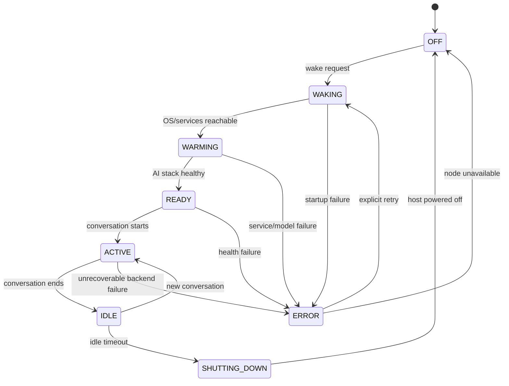

# MyAI — Compute Lifecycle

## Purpose

The local AI compute node does not need to run continuously.

A core design goal of MyAI is therefore to treat local AI as an on-demand compute capability with an explicit lifecycle.

The lifecycle should balance:

- response time;
- energy consumption;
- operational simplicity;
- hardware wear;
- observability;
- and user expectations.

The lifecycle is managed by the gateway and the compute node.

The client should not need to know how the selected backend becomes ready.

---

## Design principle

The client only needs to know one thing:

> **Is the selected AI backend ready?**

Everything behind that question belongs to the gateway and backend implementation.

For cloud providers, readiness may be immediate.

For local AI, readiness may require:

- powering on the compute node;
- booting the operating system;
- starting AI services;
- loading a model;
- verifying health;
- and only then accepting a conversation.

The client should not have to distinguish between these cases.

---

## Lifecycle overview

The intended local lifecycle is:

```text
OFF
 |
 | Wake request
 v
WAKING
 |
 | OS and services start
 v
WARMING
 |
 | Model and runtime become ready
 v
READY
 |
 | Conversation starts
 v
ACTIVE
 |
 | Conversation ends
 v
IDLE / WARM
 |
 | inactivity timeout
 v
SHUTTING_DOWN
 |
 v
OFF
```

This creates a bounded compute session rather than a permanently running AI node.

---

## States

### OFF

The compute node is powered off.

Expected behaviour:

- local AI services are unavailable;
- the gateway reports local compute as unavailable;
- a wake request may be issued;
- no model resources are consuming power.

Example:

```json
{
  "state": "off"
}
```

This is the lowest-energy and lowest-exposure state.

---

### WAKING

The gateway has initiated startup of the compute node.

Typical actions include:

- Wake-on-LAN;
- waiting for network connectivity;
- waiting for the operating system;
- waiting for required services.

Example:

```json
{
  "state": "waking"
}
```

The system should not yet accept normal conversation traffic.

---

### WARMING

The operating system and AI services are available, but the selected model is not yet fully ready.

Typical actions include:

- verifying Speech-to-Text;
- verifying Text-to-Speech;
- contacting the model runtime;
- loading the selected model into memory;
- optionally performing a minimal warm-up request.

Example:

```json
{
  "state": "warming"
}
```

The distinction between `waking` and `warming` is useful because operating system startup and model startup are different operational concerns.

---

### READY

All required local AI components are operational.

For example:

```text
STT     ready
LLM     ready
TTS     ready
```

The gateway may now allow the normal conversation path to continue.

Example:

```json
{
  "state": "ready"
}
```

Readiness should represent usable service, not merely a powered-on machine.

---

### ACTIVE

A conversation is currently using the local backend.

Relevant activity may include:

- receiving audio;
- Speech-to-Text;
- model generation;
- Text-to-Speech;
- streaming audio back to the client.

During this state the inactivity timer should not expire.

Activity should refresh the lifecycle lease.

---

### IDLE / WARM

The conversation has ended, but the compute node remains available.

The model may remain loaded in memory for a limited period.

A target reference value is:

```text
30 minutes
```

This means a second conversation during that period can start without repeating the full cold-start sequence.

Conceptually:

```text
conversation ends
      |
      v
warm idle
      |
      +------ new conversation ------> ACTIVE
      |
      +------ timeout ---------------> SHUTTING_DOWN
```

The timeout is a policy choice, not an architectural constant.

Different environments may choose:

- 5 minutes;
- 15 minutes;
- 30 minutes;
- 1 hour;
- always-on.

---

### SHUTTING_DOWN

The idle timeout has expired and the compute node is being stopped cleanly.

Expected actions may include:

- stop accepting new local work;
- finish or reject outstanding requests;
- optionally unload the model;
- flush logs;
- stop AI services if required;
- issue operating system shutdown.

Example:

```json
{
  "state": "shutting_down"
}
```

A controlled shutdown is preferable to abruptly removing power.

Physical power remains a final control, not the normal lifecycle mechanism.

---

## State transitions

A simplified transition model is:



The exact implementation may differ, but the important point is that state transitions are explicit and observable.

---

## Provider-neutral lifecycle behaviour

The lifecycle API should remain stable regardless of backend type.

Example interface:

```http
GET /compute/status
POST /compute/wake
```

For a cloud backend:

```json
{
  "state": "ready"
}
```

may be returned immediately.

For local AI:

```text
off -> waking -> warming -> ready
```

may take significantly longer.

The client does not need provider-specific logic.

This preserves the separation:

```text
Client
   |
   v
Generic readiness contract
   |
   v
Gateway
   |
   +-- cloud lifecycle
   +-- local lifecycle
```

---

## Cold start

A cold start begins when the local compute node is fully powered off.

The current reference implementation demonstrates a startup path similar to:

```text
ESP32
  |
  | GET /compute/status
  v
Gateway
  |
  | state = off
  |
  | POST /compute/wake
  v
Wake helper
  |
  | Wake-on-LAN
  v
Compute node
  |
  | boot
  | start services
  | load model
  v
READY
```

A cold start is expected to take substantially longer than a normal cloud request.

That delay should be treated as normal lifecycle behaviour, not hidden as an error.

---

## Client experience during cold start

The user-facing client should indicate that compute is becoming ready.

It should not appear frozen.

The reference implementation uses a wake-up animation while polling the gateway.

Conceptually:

```text
wake requested
     |
     v
show progress
     |
     v
poll readiness
     |
     +--> waking
     +--> warming
     +--> ready
```

The animation is a user-experience detail.

The architectural requirement is that startup state is visible rather than silent.

---

## Polling

During startup the client periodically checks readiness.

Polling should be slow enough to avoid unnecessary network traffic and TLS overhead, but fast enough to provide an acceptable user experience.

The reference implementation uses a multi-second polling interval.

Polling is bounded by a timeout.

Conceptually:

```text
wake
 |
 +--> poll
       |
       +--> not ready -> wait -> poll
       |
       +--> ready -> continue
       |
       +--> timeout -> fail visibly
```

A failed startup must not result in indefinite waiting.

---

## Readiness definition

A host being reachable does not mean AI is ready.

Readiness should verify the dependencies required for the selected backend.

For the reference local stack:

```text
compute host reachable
        +
STT healthy
        +
LLM runtime healthy
        +
selected model available
        +
TTS healthy
        =
READY
```

This avoids false-positive readiness.

---

## Model warming

The LLM runtime may require model loading after boot.

This can dominate startup latency.

A model can therefore be warmed explicitly before the backend reports `ready`.

For example:

```text
Ollama running
     |
     v
model not loaded
     |
     v
warm-up request
     |
     v
model resident
     |
     v
READY
```

The exact warming mechanism depends on the runtime.

For Ollama, a keep-alive period can be used to retain the model after interaction.

A reference target is:

```text
keep_alive = 30m
```

This should align with the broader compute idle policy where practical.

---

## Idle lease

The local compute node should not shut down immediately after each interaction.

Instead, activity creates or refreshes an idle lease.

Conceptually:

```text
activity
   |
   v
idle_deadline = now + 30 minutes
```

Any new interaction refreshes the deadline.

Example:

```text
12:00 conversation ends
12:30 planned shutdown

12:20 new conversation
12:50 new planned shutdown
```

This avoids repeated boot cycles during short bursts of use.

---

## What counts as activity

The lifecycle manager should explicitly define which events refresh the idle timer.

Candidates include:

- conversation start;
- audio received;
- STT processing;
- model generation;
- TTS streaming;
- response completion.

A practical policy is:

> Any active conversation or backend processing prevents shutdown.

The timer should normally begin after the response has completed.

---

## Shutdown policy

A shutdown should occur only when all of the following are true:

```text
local backend selected or recently used
AND
compute node is idle
AND
no conversation is active
AND
no backend work is pending
AND
idle timeout has expired
```

Before shutdown, the lifecycle manager should re-check state to avoid racing with a newly started conversation.

Conceptually:

```text
timeout reached
    |
    v
check active work
    |
    +--> active -> cancel shutdown
    |
    +--> idle -> shutdown
```

---

## Race conditions

Lifecycle operations are naturally concurrent.

Examples include:

- a new conversation arriving while shutdown begins;
- two clients requesting wake simultaneously;
- the host becoming ready between polls;
- a service failing after readiness was reported;
- a wake request arriving while already waking.

The lifecycle manager should therefore make operations idempotent where possible.

For example:

```text
wake while OFF      -> initiate wake
wake while WAKING   -> keep waking
wake while WARMING  -> keep warming
wake while READY    -> return ready
```

The same wake request should not generate multiple Wake-on-LAN sequences unnecessarily.

---

## Failure states

Startup may fail.

Possible reasons include:

- Wake-on-LAN failure;
- network failure;
- operating system boot failure;
- STT unavailable;
- model runtime unavailable;
- model load failure;
- TTS unavailable.

These should be visible as lifecycle failures.

Example:

```json
{
  "state": "error",
  "component": "llm",
  "reason": "model_unavailable"
}
```

Error detail should be useful for operations without exposing unnecessary internal or secret information to the client.

---

## No automatic cloud escape

A failed local startup should not silently transition to a cloud provider.

The lifecycle must preserve the backend choice.

Incorrect:

```text
local selected
    |
    v
local startup fails
    |
    v
silently use cloud
```

Preferred:

```text
local selected
    |
    v
local startup fails
    |
    v
visible failure
    |
    +--> explicit retry
    +--> explicit backend change
```

This keeps operational convenience from overriding sovereignty.

---

## Gateway restart

Lifecycle state should not depend solely on gateway memory.

A gateway restart may otherwise produce a mismatch such as:

```text
gateway state: off
actual services: running
```

The authoritative state should therefore be reconstructed from observable reality.

For example:

```text
gateway starts
     |
     v
probe compute node
     |
     +--> unreachable -> OFF
     |
     +--> reachable, services incomplete -> WARMING
     |
     +--> full stack healthy -> READY
```

This is preferable to trusting stale or default in-memory state.

---

## Health versus lifecycle

Health and lifecycle are related but different.

Example:

```text
state = READY
health = healthy
```

or:

```text
state = WARMING
health = healthy
```

A node may be healthy while not yet ready for user traffic.

Separating these concepts makes diagnostics clearer.

---

## Observability

Lifecycle events should be logged explicitly.

Useful events include:

```text
compute_wake_requested
compute_wol_sent
compute_reachable
compute_warming
compute_ready
compute_activity
compute_idle
compute_shutdown_requested
compute_shutdown_complete
compute_error
```

Useful timing metrics include:

```text
wake_to_network_ms
network_to_services_ms
services_to_model_ready_ms
total_cold_start_ms
warm_start_ms
idle_duration_ms
```

This allows lifecycle behaviour to be measured rather than guessed.

---

## Security considerations

Lifecycle control is a privileged capability.

An attacker who can wake or shut down compute at will can affect:

- availability;
- energy use;
- resource consumption;
- user experience.

Therefore:

- wake endpoints should not be broadly exposed;
- shutdown capability should remain server-side;
- privileged host operations should use narrow interfaces;
- the gateway should authenticate or restrict lifecycle calls appropriately;
- AI models should not automatically receive infrastructure lifecycle permissions.

A model should not be able to decide independently that a host must be powered on or off unless that capability is explicitly designed and bounded.

---

## Physical control

Normal lifecycle management should use controlled software shutdown.

Physical power is a separate, higher-level control.

The layers are:

```text
conversation control
        ↓
backend lifecycle
        ↓
operating system shutdown
        ↓
network isolation
        ↓
physical power
```

The last layer is intentionally simple:

> **Software controls are useful. Physical control is final.**  
> — MayTag

Physical shutdown is not the normal lifecycle.

It is the ultimate boundary.

---

## Reference policy

A reasonable reference policy for this implementation is:

```text
Cold node:
    Wake on first local request

Startup:
    Wait until STT + LLM + TTS are ready

Active use:
    Prevent shutdown

After conversation:
    Keep model and compute warm

Idle period:
    30 minutes

New activity:
    Reset idle timer

Idle timeout:
    Clean operating system shutdown

Failure:
    Report failure, no hidden cloud fallback
```

These values are defaults for experimentation, not universal recommendations.

---

## Design outcome

The lifecycle model enables local AI to behave as a temporary resource rather than permanent infrastructure.

The user experiences:

```text
request AI
   ↓
AI wakes
   ↓
AI becomes ready
   ↓
conversation
   ↓
AI remains warm briefly
   ↓
AI disappears again
```

The client remains simple.

The gateway remains in control.

The compute node exists only when it provides value.

That is the intended lifecycle.
