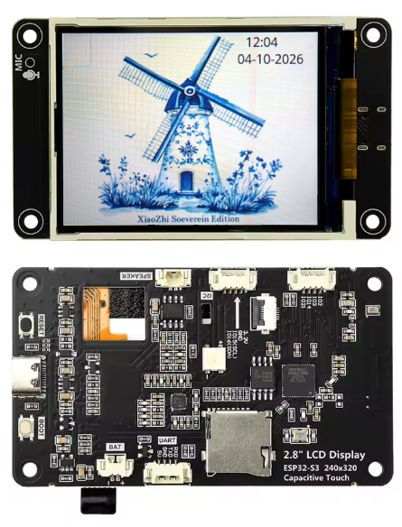
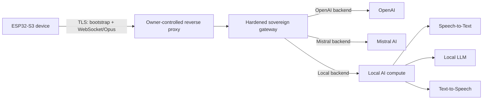

# XiaoZhi Sovereign

**A small, auditable XiaoZhi voice-assistant fork that keeps the device under your control.**

<p align="center"><sub>Sovereignty comes at a price. Your conversations may be worth a lot more.</sub></p>

<p align="center">
    <br>
    <sub>© Original product photo: Freenove, display image edited</sub>
</p>

> **Experimental reference implementation.** The firmware, gateway and multiple AI backends have been exercised together on the reference hardware, but the project is not independently audited or production-certified.

XiaoZhi Sovereign combines modified ESP32 firmware with a self-hosted gateway.

The device no longer depends on the original XiaoZhi cloud path. It obtains its configuration from infrastructure you operate and sends voice traffic only through your gateway.

The gateway can currently route conversations to:

- OpenAI;
- Mistral AI;
- a local AI compute node.

> Sovereign does not mean “everything must run locally”. It means that processing locations, dependencies and trust boundaries are explicit, controllable and replaceable.

The ESP32 does not need to know which provider is selected.

That decision belongs to the gateway.

---

## Why this project exists

Many AI devices make the user interface visible and the data flow invisible.

XiaoZhi Sovereign takes the opposite approach:

- the owner chooses the firmware, gateway and AI provider;
- the device is configured through a self-hosted bootstrap endpoint;
- provider credentials remain on the gateway and never reach the ESP32;
- sessions start through an explicit physical interaction;
- the implemented protocol surface is deliberately small;
- data flows, trust boundaries and external processors are documented;
- cloud and local backends can be replaced without replacing the physical device;
- local processing does not silently fall back to cloud processing.

The project favours understandable code and explicit boundaries over a large feature set.

---

## Architecture



The reverse proxy terminates TLS.

The gateway:

- authenticates the device;
- translates the narrow XiaoZhi WebSocket/Opus protocol;
- holds provider credentials;
- selects the AI backend;
- manages local compute lifecycle;
- provides observability and timing information.

The ESP32 never connects directly to an AI provider.

One backend configuration selects the provider while the device firmware remains provider-neutral.

---

## Provider-neutral readiness

Cloud and local AI have different operational behaviour.

A cloud backend may be ready immediately.

A local compute node may first need to:

```text
power on
  ↓
boot
  ↓
start services
  ↓
load model
  ↓
become ready
```

The ESP32 does not implement that logic.

Instead it asks the gateway whether the selected backend is ready.

Conceptually:

```http
GET /compute/status
POST /compute/wake
```

For cloud providers the gateway may answer immediately:

```json
{"state":"ready"}
```

For local AI the visible lifecycle may be:

```text
off → waking → warming → ready
```

This keeps infrastructure knowledge out of the firmware.

---

## Local AI

The local backend is operational in the reference implementation.

The current stack uses:

```text
Speech-to-Text   faster-whisper
LLM              Ollama / Qwen
Text-to-Speech   Supertonic
```

The local compute node is treated as replaceable infrastructure.

The reference implementation currently uses a refurbished x86 system because that was an economical and practical choice in this environment.

A mini-PC, workstation, server, laptop or another platform may be a better implementation elsewhere.

> **The compute node is replaceable. The architecture is the important part.**

The local backend does not create an implicit cloud fallback.

If local processing is selected and the local backend fails, the failure remains visible.

---

## Local compute lifecycle

Local AI does not need to run continuously.

The intended lifecycle is:

```text
OFF
 ↓
WAKING
 ↓
WARMING
 ↓
READY
 ↓
ACTIVE
 ↓
IDLE / WARM
 ↓
SHUTDOWN
 ↓
OFF
```

The compute node can be powered on through Wake-on-LAN when required.

The intended policy is to keep the local model warm for a limited idle period and then shut the node down cleanly.

This balances:

- startup latency;
- energy consumption;
- operational simplicity;
- and availability.

See [`MyAI/lifecycle.md`](MyAI/lifecycle.md) for the lifecycle design.

---

## Wake-up experience

Cold local startup takes noticeably longer than a cloud API request.

Rather than hiding this delay behind an apparently frozen user interface, the ESP32 displays a wake-up animation while polling backend readiness.

The reference firmware currently uses a seven-frame Delft-blue robot sequence followed by the normal windmill idle screen.

See the firmware documentation for implementation details.

---

## Repository structure

```text
ESP32-Freenove-Firmware/   Modified ESP32 firmware for the Freenove board
Docker-Gateway/            Self-hosted provider-neutral gateway
MyAI/                      Local AI reference architecture and lessons learned
docs/SOVEREIGNTY.md        Definition, trust boundaries and data processing
docs/FIRMWARE.md           Firmware changes and supported hardware
docs/GATEWAY.md            Gateway responsibilities and hardening
RELEASE-v0.1-alpha.md      Original alpha release boundary
LICENSE                    Licence and attribution for the firmware fork
GATEWAY_LICENSE            Licence for the independently written gateway
```

`MyAI/` is intentionally different from the operational documentation.

It describes architecture decisions and lessons learned rather than providing a hardware shopping list or installation recipe.

---

## MyAI reference architecture

The [`MyAI`](MyAI/) directory documents the local-AI architecture that grew out of this project.

It includes:

- [`architecture.md`](MyAI/architecture.md) — architectural drivers, boundaries and provider-neutral design;
- [`lifecycle.md`](MyAI/lifecycle.md) — local compute startup, warm state and shutdown behaviour;
- [`security.md`](MyAI/security.md) — trust boundaries, privilege separation and network exposure;
- [`lessons-learned.md`](MyAI/lessons-learned.md) — design lessons discovered while building the system.

The reference architecture deliberately separates architectural requirements from implementation choices.

---

## Differences from upstream XiaoZhi

| Area | Upstream/default behaviour | XiaoZhi Sovereign |
|---|---|---|
| Bootstrap and OTA | Upstream-configured service path | Owner-controlled HTTPS endpoint |
| AI connection | Determined by upstream deployment | Always mediated by the self-hosted gateway |
| Provider secret | Depends on server deployment | Stored only as a gateway secret |
| Backend selection | Deployment-specific | OpenAI, Mistral or local AI behind one gateway interface |
| Local compute lifecycle | Not part of client abstraction | Gateway-controlled readiness and wake lifecycle |
| Session start | Wake word and/or board controls | Explicit physical control in current reference build |
| Language/UI | General upstream assets and defaults | Dutch build, local idle artwork and conversation view |
| Gateway scope | Full server ecosystem available | Focused protocol, provider and lifecycle boundary |
| Documentation | General-purpose upstream documentation | Explicit data flow, trust boundaries and processors |

This is a focused fork, not a claim that upstream XiaoZhi cannot be self-hosted or adapted in other ways.

---

## Current status

The project is an experimental hardware-tested reference implementation, not a finished consumer product.

### Implemented

- ESP32-S3 firmware for the Freenove 2.8-inch display board used by this project;
- Dutch user interface and Delft-blue local artwork;
- self-hosted HTTPS bootstrap and secure WebSocket endpoint;
- Opus audio transport;
- OpenAI backend;
- Mistral backend;
- local backend using STT, local LLM and TTS services;
- provider-neutral compute readiness;
- Wake-on-LAN orchestration through a constrained host helper;
- local-compute warm-up handling;
- device token authentication and optional device-ID restriction;
- explicit physical session control;
- bounded post-answer listening window;
- hardened, unprivileged Docker deployment;
- metadata-oriented operational logging.

### Work in progress

- automatic local-compute shutdown after idle timeout;
- lifecycle state reconstruction after gateway restart;
- additional stream and buffer limits;
- tighter local DNS architecture;
- further SSH and management-path hardening;
- multi-device administration;
- browser-based management interface;
- independent security audit or production certification.

---

## Security and privacy position

The architecture reduces hidden dependencies.

It does not eliminate all risk.

- Audio and text leave the local network when a cloud AI provider is selected.
- Provider selection is explicit.
- Selecting local processing does not silently fall back to cloud processing.
- Provider credentials remain on the gateway.
- Local AI APIs should be reachable only from systems that require them.
- Privileged functions are isolated behind narrow interfaces.
- TLS protects transport, but endpoint compromise remains in scope.
- Physical access to the ESP32 may permit firmware extraction unless hardware security features are configured and verified.
- Logs are intended to remain metadata-oriented and should not contain API keys, device tokens, transcripts or raw audio.

See:

- [`docs/SOVEREIGNTY.md`](docs/SOVEREIGNTY.md)
- [`MyAI/security.md`](MyAI/security.md)

for the broader security and sovereignty position.

---

## Sovereignty

This project does not assume that a specific cloud provider is malicious or unsafe.

The design starts from a simpler observation:

> If the behaviour, processing location or compliance properties of an external dependency cannot be independently established to the required level, that dependency should remain explicit and replaceable.

The gateway provides that boundary.

The objective is not necessarily to eliminate cloud processing.

The objective is to retain meaningful control over:

- where processing occurs;
- which provider is selected;
- which credentials are used;
- which components can be replaced;
- which dependencies exist;
- and when compute can be stopped.

---

## Physical control

Software controls provide flexibility.

Network boundaries provide containment.

Lifecycle controls limit exposure.

But the final layer remains physical.

<p align="center">
    
</p>

> **Software controls are useful. Physical control is final.**  
> — MayTag

---

## Documentation

- [Sovereignty principles and trust boundaries](docs/SOVEREIGNTY.md)
- [Firmware design and upstream differences](docs/FIRMWARE.md)
- [Gateway architecture and hardening](docs/GATEWAY.md)
- [Mistral backend: setup, tuning and limits](Docker-Gateway/docs/mistral.md)
- [MyAI reference architecture](MyAI/README.md)
- [MyAI architecture](MyAI/architecture.md)
- [MyAI lifecycle](MyAI/lifecycle.md)
- [MyAI security](MyAI/security.md)
- [MyAI lessons learned](MyAI/lessons-learned.md)

---

## Upstream and licenses

The firmware is derived from the [XiaoZhi ESP32 project](https://github.com/78/xiaozhi-esp32) and retains upstream attribution. See [`LICENSE`](LICENSE).

The gateway is independently written for this project and is distributed under Apache-2.0. See [`GATEWAY_LICENSE`](GATEWAY_LICENSE).

XiaoZhi Sovereign is an independent project and is not an official XiaoZhi distribution.
